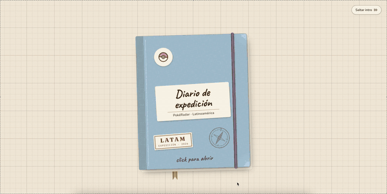

# PokéRadar · Diario de expedición

Un mapa de Latinoamérica dibujado como libreta de campo, donde viven los 151 Pokémon de la primera generación. Elegís un destino, un compás revela a los Pokémon del lugar y cada uno que descubrís queda sellado en tu libro de sellos.

**[Ver la app →](https://pokeradar-latam.vercel.app)**



## 1. Concepto y narrativa

Quise que explorar se sintiera como una expedición y no como un dashboard. La interfaz es el diario de una naturalista: un mapa en sepia con agua color papel, costas en tinta y grilla de papel milimetrado, con stickers, garabatos y una rosa de los vientos.

**El recorrido:**

- **Abrís el diario.** La primera vez completás tu credencial de exploradora o explorador (nombre y foto) y la sellás. Si volvés, el diario se abre solo. Se puede saltear con «Saltar intro» o Esc.
- **Elegís un destino.** Hay 42 destinos reales, de Iguazú a Isla de Pascua, agrupados en seis regiones. Cada Pokémon vive en uno según su hábitat en PokéAPI (cueva, bosque, montaña, mar…).
- **El compás revela.** La cámara vuela hasta el lugar y el brazo de un compás traza un círculo. Los Pokémon aparecen como siluetas a medida que pasa.
- **Descubrís tocando.** Tocar una silueta muestra el sprite, abre la ficha y suma un sello. Un anillo alrededor de cada destino muestra cuántos te faltan.
- **La ficha** muestra tipos, estadísticas, el grito del Pokémon y la descripción de la Pokédex en español como nota manuscrita. El link se puede compartir (`?pokemon=25`).
- **El libro de sellos**, inspirado en los _eki stamps_ de las estaciones de Japón, tiene una página por hábitat, con lugar y fecha en cada sello. Al completar una página aparece un sello dorado de completitud.

**Qué aporta a la UX.** La geografía le da sentido a la búsqueda: un Pokémon de mar está en la costa y uno de montaña, en los Andes. El barrido del compás le da ritmo a cada llegada en lugar de mostrar todo de golpe. El libro de sellos da un motivo para volver y completar páginas. Llegar a cualquier ficha lleva como mucho tres toques, y todo se puede recorrer con teclado y sin el mapa.

## 2. Arquitectura y stack

| Librería                                        | Para qué                                                               |
| ----------------------------------------------- | ---------------------------------------------------------------------- |
| **Next.js 16** (App Router, Cache Components)   | Shell en el servidor, roster cacheado, metadata e imagen OG            |
| **React 19** + **TypeScript** estricto          |                                                                        |
| **Tailwind CSS v4** + **shadcn/ui**             | Tokens del diario en `@theme`; componentes de shadcn reestilizados     |
| **MapLibre GL** (`react-map-gl`)                | Mapa vectorial sobre OpenFreeMap, recoloreado                          |
| **TanStack Query**                              | Pedidos de la ficha con caché, reintento y estados de carga y error    |
| **Zod 4**                                       | Validación de cada respuesta de PokéAPI y de lo guardado localmente    |
| **motion**                                      | El compás, las apariciones y el diario; respeta el movimiento reducido |
| **Vitest**, **Testing Library**, **Playwright** | Tests unitarios, de componente y end-to-end                            |

### Carpetas

```
src/
  app/            layout, page (servidor), providers, ícono e imagen OG
  components/
    Intro/        el diario que se abre y la credencial de exploradora o explorador
    Expedition/   compone mapa, diario lateral, HUD y ficha
    Map/          mapa, sellos de destino, marcadores, compás, anillo de progreso
    Panel/        la ficha del Pokémon: pestañas, estadísticas, nota de campo, grito
    StampBook/    el libro de sellos y sus páginas
    Hud/          guía de destinos, controles, silencio
    Decor/        papel milimetrado, rosa de los vientos, stickers
    ui/           componentes de shadcn
  hooks/          selección y URL, cámara, descubrimientos, credencial, sonido
  lib/
    pokeapi/      cliente, schemas de Zod y roster (sólo servidor)
    biomes/       los 42 destinos, reparto por hábitat, posiciones, orden del barrido
    map/          estilo del mapa, cámara, agrupamiento de sellos
    discovery/    descubrimientos guardados y selectores del libro
    explorer/     la credencial guardada
    sound/        gritos y preferencia de silencio
    storage/      localStorage con respaldo en memoria, compartido por los stores
  utils/          formateo de nombres, tipos y helpers
  test/           datos compartidos por los tests (los Pokémon de Gen 1 por hábitat)
e2e/              test de Playwright y fixtures
```

La regla general es que la lógica vive en `lib/` como funciones puras y testeadas, sin React. Los componentes sólo dibujan, y los hooks conectan unas con otros.

### Decisiones técnicas

- **Datos.** El servidor arma el roster una vez por día con 9 pedidos a PokéAPI (uno por hábitat) y lo cachea con `"use cache"`. La ficha pide `/pokemon` y `/pokemon-species` desde el cliente, en paralelo. Si falla sólo la especie, la ficha se muestra igual y únicamente la nota ofrece reintentar.
- **Ubicación determinista.** Los Pokémon de cada hábitat se reparten en ronda entre sus destinos (máximo 5 por lugar) y se ubican en espiral alrededor del centro. El mapa es idéntico en cada carga y no tiene superposiciones.
- **Estado en la URL.** `?pokemon=<id>` usa el historial del navegador: abrir una ficha agrega una entrada, cambiar de Pokémon la reemplaza y Atrás la cierra.
- **Persistencia.** Los descubrimientos, la credencial y el silencio viven en `localStorage`, leídos con `useSyncExternalStore` para no romper la hidratación. Si el storage no está disponible, la sesión funciona igual en memoria.
- **Accesibilidad.** Destinos y Pokémon son botones alcanzables con teclado, y todo el texto cumple contraste AA. Con movimiento reducido no hay vuelos de cámara ni compás. Lighthouse (build de producción) da 100 en accesibilidad y en buenas prácticas, en mobile y desktop.

### Tests y cómo correrlo

Hay más de 170 tests unitarios y de componente (la lógica de dominio, los schemas, los stores y la ficha). El end-to-end recorre el flujo completo a 1440 px y 375 px: la intro, descubrir un Pokémon, el link compartido, el libro de sellos y los errores. Corre sin red, con PokéAPI y el mapa en fixtures. En cada push, CI corre lint, tipos, formato y los tests unitarios.

Requiere Node 24.

```bash
npm install
npm run dev       # http://localhost:3000
npm test          # Vitest
npm run test:e2e  # Playwright
```

## 3. Uso de inteligencia artificial

Trabajé con **Claude Code** como par de programación.

**Para qué la usé:**

- Armar un plan por fases (mapa, revelado y cámara, ficha, libro de sellos, intro) con criterios de terminado y chequeos de tipos, lint, tests y build al final de cada fase.
- Implementar y escribir los tests. Los datos de PokéAPI y las APIs de Next 16 se verificaban en vivo o en la documentación instalada, no de memoria.
- Revisar la UI con capturas de Playwright en desktop y mobile.

**Cómo la guié.** Un archivo de reglas fija las convenciones: TypeScript sin casts, Zod para todo JSON externo, shadcn antes que componentes propios y respetar el movimiento reducido. A partir de mi pedido, la IA hace sugerencias a la propuesta y yo reviso, pregunto y decido. Todos los commits son míos, luego de revisar el output de la IA.

**Dónde se equivocó y cómo intervine:**

- **Validación escrita dos veces.** Generó tipos y _type guards_ a mano que describían la misma forma de datos, sin nada que los mantuviera sincronizados. Le propuse Zod: ahora cada schema es la única fuente de verdad y los errores nombran el campo que falla.
- **Defendía sus decisiones en vez de revisarlas.** Su marcador de destino usaba un `<button>` nativo en lugar del `Button` instalado, un `<span>` extra sólo para dibujar un aro y una etiqueta que no se podía clickear. Defendió cada punto hasta que lo cuestioné directamente. Exageró además el riesgo, diciendo que Lighthouse marcaría un `<div>` dentro de un botón, cuando sólo lo marca un validador HTML. Quedó una variante `stamp` del `Button`, sin DOM extra.
- **Dijo que dos cosas eran iguales sin mirarlas.** Afirmó que los stickers ya usaban los colores de los hábitats. No era así: se veían distintos por el relleno, no por el borde. Al cambiar la paleta, además, cambió los stickers sin avisar.
- **Reportó como terminada una animación que no corría.** Mostró capturas del diario abierto, pero la tapa saltaba directo al final, y en mobile no se animaba nada. Lo encontró recién cuando le pregunté por un detalle que yo no veía y revisó la animación cuadro por cuadro.

## 4. Próximos pasos

Con una semana más:

### Producto

- **Explorar en lugar de revelar.** Hoy el compás muestra a todos los Pokémon del destino apenas llegás. Me gustaría que el radar dependiera de vos: recorrer la zona y seguir pistas que aparecen en pantalla («se oyen aleteos cerca del río», huellas, pasto que se mueve, un grito a lo lejos) hasta encontrar a cada uno. Buscar se volvería la parte central del juego.
- **Misiones.** Objetivos cortos que den un motivo para elegir un destino y no otro: «encontrá tres Pokémon de tipo agua», «completá un destino de los Andes», «sellá una página del libro». Cada misión cumplida dejaría su propio sello en el diario.
- **Clima real.** Con [Open-Meteo](https://open-meteo.com/), el clima actual de cada destino cambiaría la expedición: si llueve en Iguazú, aparecen más Pokémon de agua; con tormenta, los eléctricos. Cada visita sería distinta, y una nota del diario contaría el clima del día.
- **Compartir el progreso.** Una imagen del libro de sellos o de la credencial para compartir, generada con `next/og` y las tipografías del diario.

### Técnico

- **End-to-end y regresión visual en CI.** El e2e ya corre sin red, así que puede sumarse al CI tal como está. Agregaría capturas con `toHaveScreenshot` a 1440 px y 375 px, porque gran parte del valor está en cómo se ve.
- **Tests de componente más allá de la ficha.** Hoy sólo la ficha los tiene. El libro de sellos y la intro tienen estado propio que vale la pena cubrir sin depender del e2e.
- **Presupuesto de rendimiento.** El mapa WebGL es el costo principal. Mediría en celulares de gama baja reales, sumaría Lighthouse CI con un límite para LCP y peso de JavaScript, y evaluaría diferir la carga de tiles fuera de pantalla.
- **Imagen OG** con las tipografías del diario (hoy usa la fuente por defecto de `next/og`).
- **Más generaciones.** El reparto ya funciona por hábitat, así que sumar otras generaciones es sobre todo trabajo de datos y de diseño del mapa.

## Créditos

- Datos, sprites y gritos: [PokéAPI](https://pokeapi.co/). Fotos de la credencial: sprites de entrenadores de [Pokémon Showdown](https://play.pokemonshowdown.com/).
- Mapa: [OpenFreeMap](https://openfreemap.org/), [OpenMapTiles](https://openmaptiles.org/) y [OpenStreetMap](https://www.openstreetmap.org/copyright).
- Las ilustraciones SVG (compás, rosa de los vientos, stickers, garabatos) son originales.

Proyecto no oficial y sin fines comerciales. Pokémon es una marca de Nintendo, Game Freak y The Pokémon Company.
